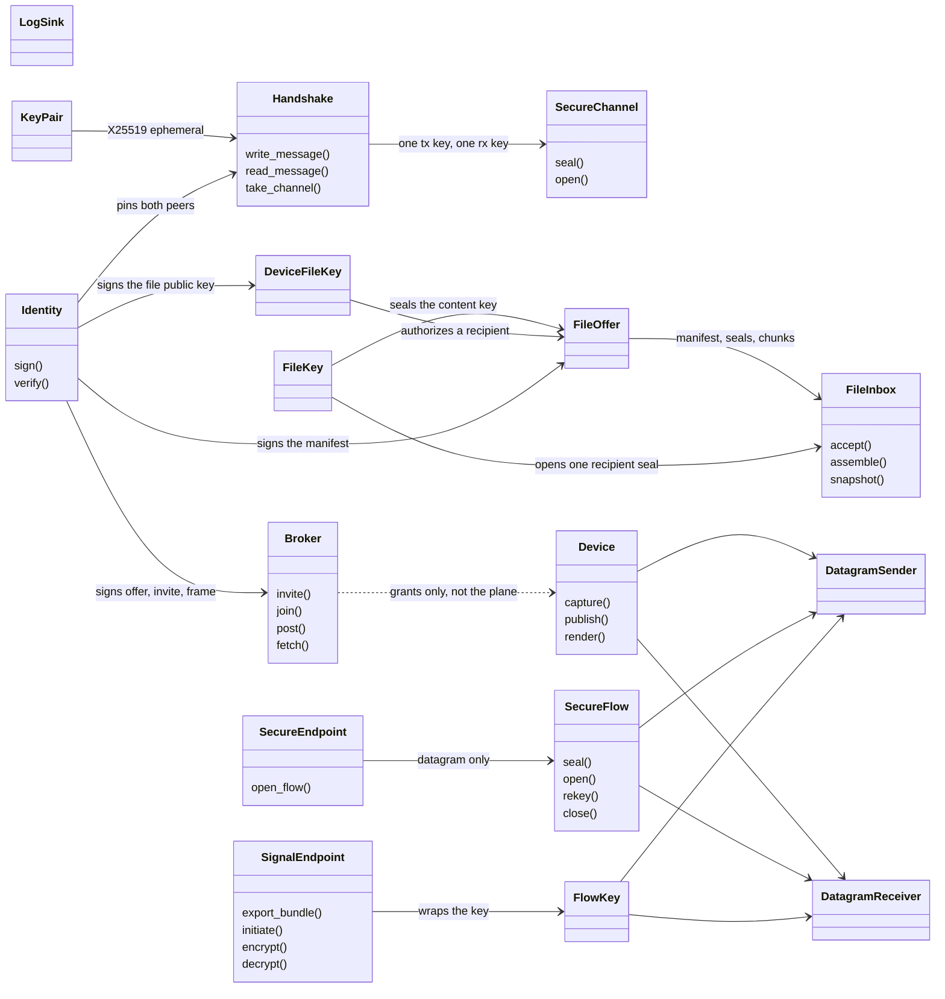
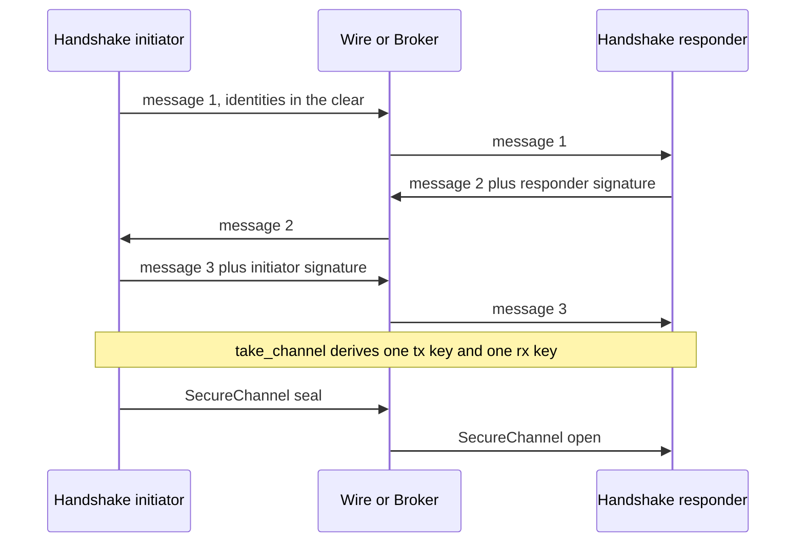
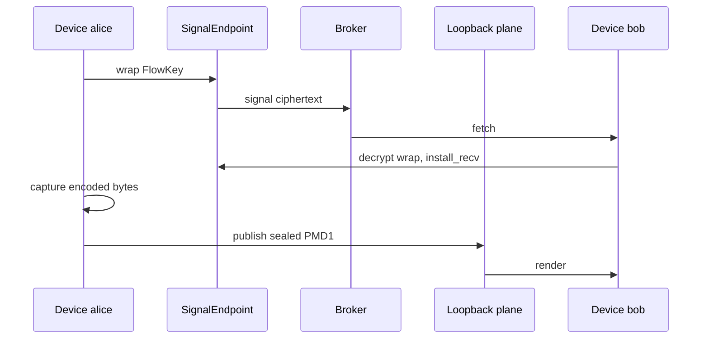

# Design overview

**Date:** 2026-11-16  
**Scope:** the public types in `packages/encryption.cpp` as they compile in the dev preset.  
**Purpose:** class relations, the data they hold, and the flows a reviewer can check. This is not a protocol proof. The byte layouts are in `docs/protocol-model.md`. SA-15, SA-16, and SA-17 in `security-assessment.md` stay open.

Payload bytes are opaque. The library does not parse a codec, a container, or a file format. It does have more than one envelope, and those envelopes do not share one interface.

## Layout

| Namespace | Role |
|---|---|
| `pm::encryption` | Identity, online channel, file envelope, signal session, datagram flows |
| `pm::room` | In-process broker: pairing, membership, opaque frames |
| `pm::host` | Test host: capture queue, loopback plane, render log |

One static library holds all three. `packages/room.cpp` does not exist yet. The root build does not link this library. Tanit, Android, and `tanit-cli` do not call it.

`PolicyId` is a feature switch, not a base class. `LiveSession` and `UnauthenticatedKx` are on by default. `Signal` follows `PM_ENCRYPTION_LIBSIGNAL` (off in `option()`, on in the dev preset). `Mls` is off. There is no `ISession`.

`LogSink` is the only virtual interface. The library does not own a process-global logger.

## Classes



`SecureFlow` is the caller API for opaque bytes. It opens a datagram. Reliable delivery stays on `SecureChannel`. Durable objects stay on `FileOffer`. `DatagramSender` seals `PMD1/v1`. The host-chosen flow id and scope, and the epoch, are in the header. `Device` still labels microphone and camera for the test adapter. Those labels select a flow id. They are not a content type.

`SignalEndpoint` is not an `Identity`. Its address is the string passed to `open("alice")` plus device id 1. The Ed25519 key that signs broker frames is a separate object, built from a seed in the harness.

## Data

| Object | Secret it holds | What a copy can do | Lifetime in this tree |
|---|---|---|---|
| `Identity` | Ed25519 seed | Sign handshakes, manifests, broker frames | Process. Not stored |
| `KeyPair` | X25519 ephemeral | Derive one channel direction | Handshake, then inside `SecureChannel` |
| `SecureChannel` | One tx key, one rx key | Decrypt every frame in that direction, past and future | Process. `k_channel_ratchet` is false |
| `FileKey` | X25519 file key | Open content keys sealed to it. Cannot sign | Process |
| `DeviceFileKey` | None. A signature over the file public key | Name the file key a pinned device accepts | The version and window in the statement |
| `FileInbox` | Symmetric content key, plaintext pieces | Read the file | Until destroy. Snapshot copies the plaintext |
| `SignalEndpoint` | libsignal in-memory store | Decrypt the session's history and future messages | Process. Not saved |
| `FlowKey` | 32-byte symmetric key, flow id, scope, epoch | Seal and open that flow for that epoch | Process. Wrapped once through signal |
| `Broker` | None. Signatures and opaque frames | Replay stored frames. Cannot decrypt | Process. Cap 256 frames, 16 KiB each |
| `Device` | The send and receive flow keys it installed | Publish and render those flows | Process |

Room records:

| Record | Signed by | Covers |
|---|---|---|
| `PairOffer` / `PairAccept` | The device that created it | Pairing id and the public keys in that message |
| `Invite` | Room owner | Room, epoch, owner, invitee, grant bits |
| `Envelope` | The posting member | Room, epoch, broker sequence, sender, frame bytes |
| `Room` at create | Owner | Id, epoch, owner. Not the member list. Not the grants |

`Room.grants` starts as chat. `join` ORs the invite grants into that field in memory. Nothing re-signs the room afterward.

Broker frames have no content type. A prekey bundle, a chat ciphertext, and a media-key wrap are the same `Envelope.frame`.

File `name` and `media_type` are caller strings inside the signed manifest. They are length-checked and stored. They are not interpreted.

## Flows

### Online channel

Used by `chat-harness` and `room-harness`. Both peers already know the other's Ed25519 key.



The first accepted frame sequence is 0. A higher sequence before that returns `Stale` and does not move the window. After 0, 64 frames may arrive out of order. A failed open does not move the window.

`SecureChannel::initiator` and `responder` exist when `PM_ENCRYPTION_UNAUTHENTICATED_KX` is on. They do not bind `Identity`. The chat harness refuses that path. The type is still in the library.

### Room

`Broker` checks signatures and membership. It does not decrypt. `post` does not look at grant bits. Any member can post any opaque frame up to 16 KiB.

File bytes never enter `post` in `scenario group-file`. The scenario uses `vfs.cpp` as the mount. The grant bit `k_grant_files` is defined and `invite` rejects it. The file API does not read room grants.

### Signal text

`signal-room`. Bob exports a prekey bundle, posts it, Alice `initiate`s, then `encrypt` / `decrypt` go through the broker as opaque frames. The session is upstream libsignal 0.108.0: PQXDH, then the Triple Ratchet.

The signal peer name and the Ed25519 member key are not bound. The harness uses the same two people for both. The types do not require that.

### Media

`media-room` checks the frame rules. `media-host` is the test host around them.



The plane is a `vector` in the CLI. `Broker::post` is not on that path. Nothing in `Broker` stops a caller from posting a datagram anyway.

A lost datagram sequence is a gap. The first sequence does not have to be 0. The window is still 64. A modified frame fails authentication, including when that sequence was already accepted. The window moves only after authentication and the replay check both succeed. A repeated intact sequence is `Replay`. A new epoch does not open the previous epoch. A peer who kept the previous key still can. Mute drops the capture queue and does not seal. `k_grant_audio` and `k_grant_video` are checked by `Device::publish`, not by `Broker::post`. The host maps those grants onto the `mic` and `cam` flow ids.

### File

`create_authorized_file_offer` checks each recipient's `DeviceFileKey` against the pinned Ed25519 identity, the pinned version, and the statement's time window, then calls `create_file_offer`. That function mints a content key, chunks the plaintext, seals that key to each recipient `FileKey`, and has the Ed25519 `Identity` sign the manifest. The statement is not a field of the offer. `create_file_offer` still seals whatever public keys it is given. `FileInbox::accept` takes chunks in any order. A second ciphertext at an accepted index is a replay. `assemble` requires every chunk and the content hash. `reseal_file_chunk` always returns `InvalidArgument`. Dropping a recipient from a later revision does not make an older ciphertext unreadable.

## Delivery

| Adapter | Entry | Loss | Who can open it |
|---|---|---|---|
| Online channel | `SecureChannel` | Reorder inside 64 after sequence 0. No gap before 0 | The peer that finished the handshake |
| Signal session | `SignalEndpoint` | Ratchet skip, upstream rules | The named signal peer |
| Datagram flow | `SecureFlow`, over `DatagramSender` | Gap allowed. Replay of a sequence rejected | Holder of that flow id, scope, and epoch |
| Durable artifact | `FileOffer`, `FileInbox` | Missing chunk stays missing until resume | Each `FileKey` named in a recipient seal |

`SecureEndpoint::open_flow` opens a datagram. Reliable and durable requests return `InvalidArgument`. A file keeps its own envelope because a missing chunk is resumed and the content key is sealed per recipient. That split is the delivery rule, not a content type.

## Weak points

These are visible from the types. They are not claims that a test failed.

1. **The facade opens datagrams.** `SecureFlow::seal` / `open` is the byte API. `SecureChannel` and `FileOffer` are still separate engines. `open_flow` refuses to pretend a datagram is a reliable channel or a file.

2. **The test host still has two slots.** Microphone and camera are flow ids `mic` and `cam`. A third host source is another slot in `Device`, not another cipher class.

3. **The signal identity is not the room identity.** `SignalEndpoint` is a string name. `Identity` is Ed25519. The broker will store a bundle or a key wrap from any member, for any name. The harness happens to use `"alice"` and `"bob"`.

4. **Grants are not on the data path that matters.** `invite` can carry audio and video, and `join` ORs them into `Room.grants`. `post` ignores grants. `Device` enforces them only when the test host calls `publish`. File transfer ignores `k_grant_files` and the broker rejects that bit. Membership is not a signed log. Create-time `room_bytes` does not include members or grants.

5. **The broker is an opaque log with a polite convention.** Media and file bytes stay off it because the CLI does not post them. The type cannot tell a key wrap from a camera packet. Both fit under the 16 KiB cap.

6. **A room grant is not a room key.** Audio and video grants sit on the room. The track key is wrapped to one signal peer. A third member with the grant bit still cannot render. There is no group media key.

7. **One flow key seals and opens.** A leaked `FlowKey` forges and reads that epoch. The signal wrap protects the key in transit. The flow itself does not ratchet. `rekey` installs a new epoch on the caller and returns a wrap. It does not delete a key a peer kept. A `SecureChannel` key has the same forge-and-read property for the whole process, and that one is documented as `k_channel_ratchet = false`.

8. **One replay bitmap, two rules.** `ReplayWindow` is shared. `SecureChannel` uses `SequenceZeroThenWindow`. A datagram uses `AnySequenceThenWindow`. A failed preview does not move the window.

9. **Nothing here is durable.** Signal sessions, skipped media keys, broker logs, and file pieces die with the process. `FileSnapshot` can copy plaintext. Its destructor wipes that copy. Other copies the caller made do not.

10. **The unauthenticated constructor is still a public factory** when the default CMake option is on. The pinned handshake is a different type. A caller can build a channel that never saw an `Identity`.

11. **`PolicyId` is still a feature list.** It reports which providers the build compiled. It does not select the flow. The dev preset compiles signal. The option default stays off.

12. **The harnesses repeat the pairing script.** `signal_room.cpp`, `media_room.cpp`, and `media_host.cpp` each open identities, a broker, and a signal session. There is no shared driver. A fix in one setup is easy to miss in the others.

## Accepted direction

A review of this map is mostly sound. The public surface has started to name audio, video, and chat. The library should protect bytes inside a security context and should not inspect what those bytes are.

Three concerns stay independent:

| Concern | Decides | Does not decide |
|---|---|---|
| Security | Who can seal, open, and rotate keys for a context | What the application does when membership changes |
| Delivery | Whether loss, reorder, retry, or resume is allowed | Which product feature uses that mode |
| Authorization | Which identity may publish or receive a given flow, once a policy says so | That the last member to leave becomes the authority |

Content type is not a fourth cryptographic dimension. A camera, a chat, a sensor, or a document picks a delivery mode when the flow opens. The library does not infer it from the bytes.

The caller surface. Datagram is the path `open_flow` implements. Reliable and durable one-shot seal are refused:

```text
SecureEndpoint
  open_flow(peer or group, FlowOptions) -> SecureFlow

FlowOptions
  delivery    datagram | reliable message | durable object
  scope       who may publish and receive, as the host declares it
  id          flow id, bound into the authenticated context
  limits      size, replay window, epoch rules for this flow

SecureFlow
  seal(bytes) / open(bytes)
  rekey() and close() when the selected provider supports them
```

`SecureFlow::seal` / `open` cover datagrams. A durable object keeps chunk, checkpoint, and resume beside that, because one shot of `seal` cannot commit a large object without hiding the state. Signal, the online channel, and the file envelope keep their own framing. Not every provider supports every delivery mode. An unsupported pair fails. It does not fall back to a weaker mode.

The datagram envelope is `PMD1/v1`. The host-chosen flow id and scope, and the epoch, are bound into the frame. `Device::capture` stays a test adapter. `SecureChannel` stays the online provider. `SignalEndpoint` stays an optional session and key-distribution provider. `FileOffer` stays the durable-object engine. `Broker` still routes opaque frames. `PolicyId` reports the providers a build compiled.

### What stays a policy input

The application has not fixed these, so the crypto must not:

- A flow or a key does not expire because the last member left.
- The last member does not become the authority by leaving, or by being the only one left.
- Leaving does not, by itself, revoke ciphertext a member already holds. The file envelope already behaves that way for a dropped recipient. Chat and datagram keys do not inherit a different rule until a policy sets one.
- A room-level grant bit does not mean every member shares one key. It also does not mean they do not. Pairwise wrap and a later group key are both legal. The flow's scope says which one this context uses.
- Rekey is an operation the provider can expose. What triggers it — time, epoch, membership, or an explicit host call — is outside the cipher.

`Room.grants` OR'd across the whole room, and `Device::publish` checking audio versus video, are stand-ins. They are not the authorization model. A production broker can enforce publish rights for a `flow_id` and a scope only after that scope is authenticated per member and bound into the packet or the key. It still does not learn whether the bytes are a camera.

Identity keys stay separate objects: Ed25519 signing, X25519 agreement, the signal prekey identity, the file recipient key, and later an MLS credential. What the library owes is a verifiable binding among them when a policy asks for one. A signal name string is not that binding. Rotation and who is trusted after a rotation are stored by the host.

### Order, when we change code

The package stops growing new wire protocols. `PMEH`, `PME2`, `PMD1`, and `PMFO` stay as they are, with their tests. A new envelope needs a requirement that libsodium, Noise, TLS, WebRTC, HPKE, or libsignal cannot already meet.

The LAN is that requirement for the live channel. Two paired devices on ordinary Wi-Fi have no Tailscale and no WireGuard. `PMEH` / `PME2` is the encrypted channel for that path. Tailscale, when it is present, is only the underlay. It authenticates a tailnet node. It does not authenticate the Ed25519 device, and it is absent often enough that the channel stays.

Replacing `PMEH` with Noise or TLS is an evaluation, not a rename. The pinned identity is Ed25519. A stock Noise static key is an X25519 agreement key. Binding those two is its own design.

WebRTC already encrypts media with SRTP and data channels with DTLS. This tree does not add a second media cipher. SFrame is in scope only if an untrusted forwarder must be unable to read the media. File bytes on untrusted storage stay on `FileOffer`. Ordinary VFS copies can ride the LAN channel. libsignal stays optional and isolated. MLS stays compiled out.

`TextSession` is the chat call a desktop process and an Android host share. The host passes `live_session` or `signal` and moves the bytes. There is no socket in the type. `TextRoom` holds one `TextSession` per peer and prefixes each frame with the recipient identity so the other members can ignore it. That prefix is not a group key. A room grant still does not create one. `unauthenticated_kx` and `mls` are refused.

`SecureEndpoint::open_flow` opens datagrams. Channels and files keep their own calls. The broker stays a membership log. It does not become part of the cipher.

Still open inside the types that exist: persistence, per-member grants, and a binding from an Ed25519 member to a signal address. A passing harness does not close them. Windows, Linux, and Android are still unproven together. The CLI entries for a later manual pass are `chat-harness`, `flow`, `signal-room`, and `media-host`.

## What this tree does not contain

A microphone, a codec, a WebRTC socket, a listening broker, Sesame, MLS, a persisted signal store, and a binding from an Ed25519 member to a signal address. Those are absent on purpose. The gaps in the section above are inside the types that already exist.
